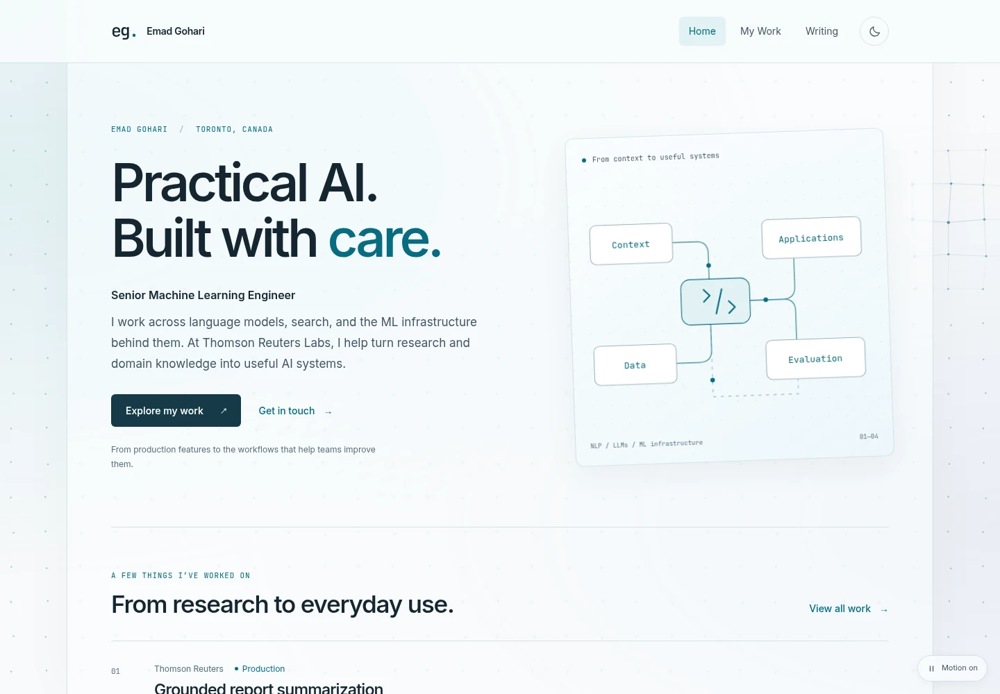
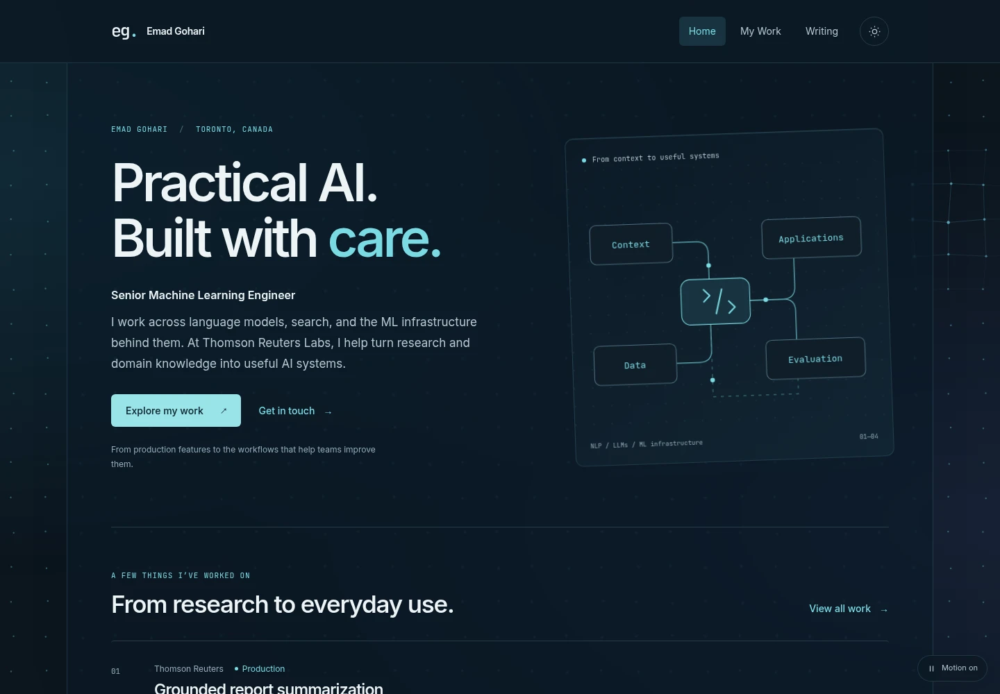
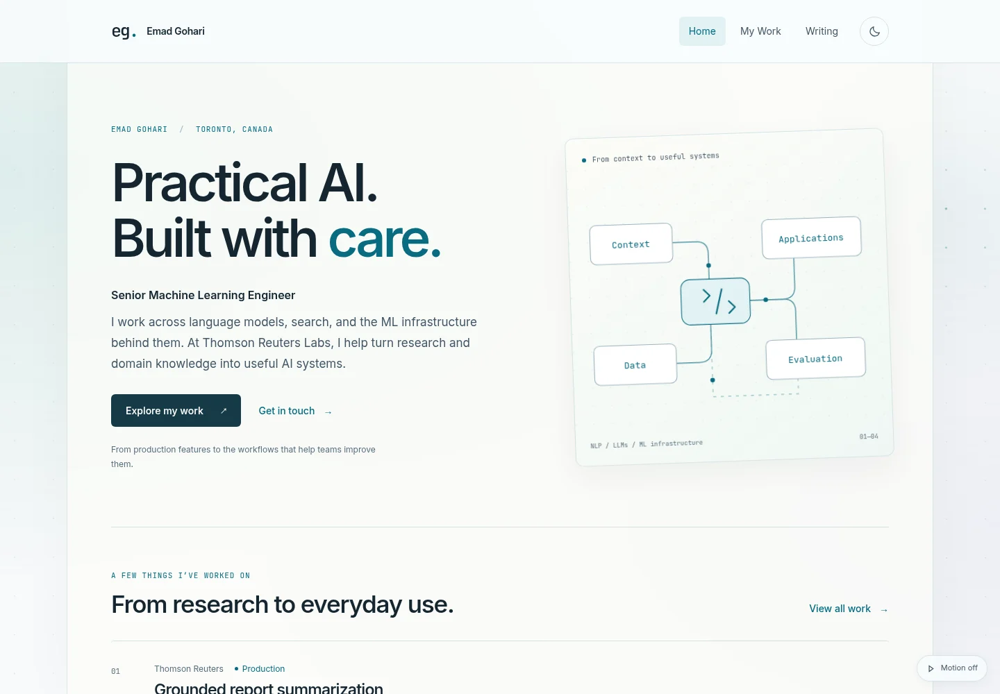
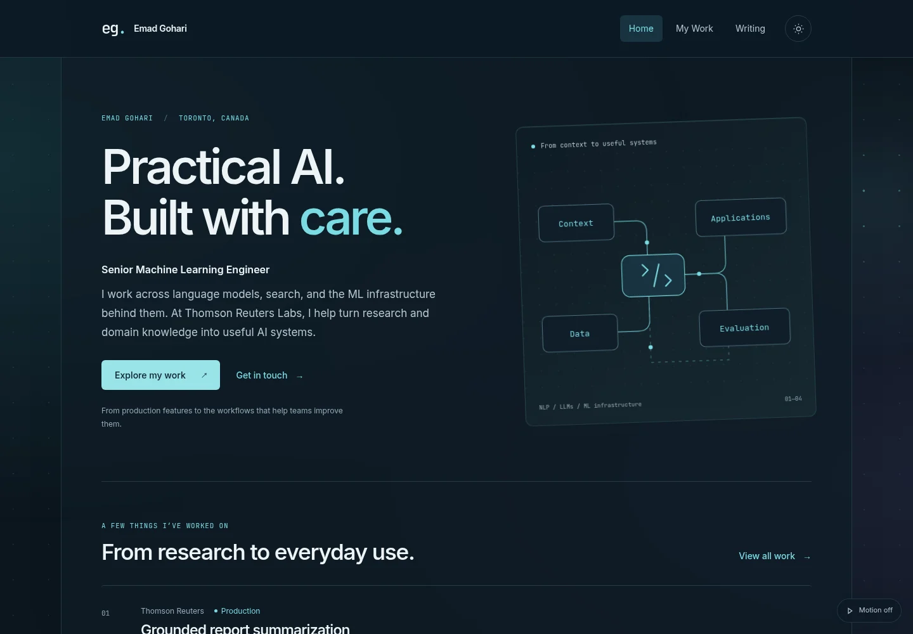

# Interactive glass visual experiments

Base: `feat/home-and-work-portfolio` at `1f34888`. The approved content, storytelling, routes, and PDF sources stay intact. The completed base is backed up on GitHub before experimentation.

## Direction and comparison

GPT Astra recommended two restrained directions, originally built on the same content, geometry, and motion engine:

|           | Anchored lattice (primary)                                              | Soft field (alternative)                                |
| --------- | ----------------------------------------------------------------------- | ------------------------------------------------------- |
| Branch    | `experiment/glass-lattice`                                              | `experiment/glass-field`                                |
| Grid      | Square anchors with very small independent movement                     | Same anchors, softer wave-like movement                 |
| Cursor    | Nearby points brighten; short horizontal/vertical neighbor links appear | A diffuse local halo and brighter points, without links |
| Glass     | Cool, clear frost with a readable central surface                       | Softer frost and a broader quiet color wash             |
| Character | Precise and technical                                                   | Soft and atmospheric                                    |

**Selected direction: Anchored lattice.** Emad selected the lattice after the initial comparison and requested more discoverable motion and glass depth. The lattice branch now contains the refinements below; Soft field remains the original alternative snapshot. Both preserve the new content and its reading hierarchy.

## Selected lattice refinement

### Approved text-size preference

The approved frost/motion work is committed separately as `6739e93`. The owner also approved the subsequent readability option for the PR. The **Aa** button beside the theme control switches all website typography between normal and 25% larger text, with a saved preference, keyboard support, and pressed-state feedback. Narrow headers reflow into two rows; measured header height preserves sticky navigation and anchor offsets. The PDF route and downloads keep their own layout. No videos are generated; snapshots are local in `.local/visual-previews/text-size-review/`.

Verification passed: production build, targeted source TypeScript, formatting/whitespace checks, and **418 production browser checks**, including 89 text-size checks. Larger text was checked across all four routes at 320, 390, 768, 1440, and 2560px in both themes, plus keyboard operation, saved/cross-tab/restored-page preferences, blocked storage, no JavaScript, expanded details, and 200% root-font reflow. Astra approved desktop/mobile snapshots and the enlarged illustration labels with no remaining findings.

### Integration for the PR

The branch incorporates the newer public resume update from `main` (`3d9ae4f`), retaining its resume facts, both generated downloads, and shared tailoring-skill ownership. Portfolio project IDs and featured skill references follow the renamed source entries; Home metadata uses the current resume headline and summary while preserving the approved landing copy. The current ATS template and download already have plain section headings without `>` prefixes.

Final integration verification passed the production build, **419 browser checks** (including 44 focused visual checks), targeted source TypeScript, formatting, and whitespace checks. A reduced-motion transition exposed a missed browser preference notification: the animation loop now refreshes the static grid and controls when its guard detects that animation is disallowed. The keyboard-resume check also waits for an actual paint before testing the next preference transition. Astra reviewed the correction with no remaining findings. All three ATS PDF pages were visually inspected, and extracted text confirmed six plain section headings. No videos are reachable in the branch history.

### Approved frost and motion revision

The owner approved this revision after reviewing the local live preview. It is preserved as a separate commit before adding the text-size preference. No new videos were generated. Snapshots are local only in `.local/visual-previews/frost-review/`, relative to the repository root.

- Restore the original site's glass approach: a low-opacity tint (40% light / 24% dark) over a 5px backdrop blur, plus more translucent header and card surfaces with stronger local blur.
- Increase independent idle hovering to about 5px × 4px with 7–9 second cycles. A tiny fixed reference dot marks each anchor; this separate CSS layer stays faint but crisp over the frost.
- Increase base dot radius to 1.8px and the cursor radius to 260px. Nearby dots grow to about 3.2px while their orbit contracts slightly. Additional cursor displacement is smaller; the combined 6px bound remains.
- Hold the local cursor response briefly after activity, then fade it gradually while the cursor and scroll position stay still. Mouse movement and scrolling revive it. Idle hovering continues throughout.
- Send one or occasionally two brief currents through 2–3 neighboring links every 1.5–2 seconds. A short moving gradient trail replaces abrupt whole-link flashes; at most three paths coexist. All static preferences and Motion off clear them.

Verification passed: production build, targeted source TypeScript, formatting/whitespace checks, **43 focused visual checks**, and **329 full production browser checks**. The full suite covers both themes, four viewport widths, keyboard/native interactions, motion preferences, blocked storage, no JavaScript/canvas, idle fade, scroll/pointer reactivation, current rendering bounds, and clean reset. Astra approved desktop/mobile snapshots and source with no remaining findings.

The previous committed refinement and verification record follow for context.

- Every point continuously hovers around its own fixed anchor when motion is on, including when the cursor is elsewhere. The baseline ellipse has approximately 2.2px horizontal / 1.8px vertical reach and 10–13 second cycles, with independent phases.
- A nearby cursor gently changes the orbit, nudges points outward and sideways, and reveals short links between immediate grid neighbors. Cursor position and strength ease over time; combined displacement is capped at 6px from each anchor.
- **Motion off resets the whole scene:** exact regular anchors, uniform dot sizes, zero cursor highlights, and zero links. It clears the previous interaction and clock rather than freezing a frame. Turning motion on softly reintroduces hovering.
- Desktop reading glass uses 62% fill and 1.1px blur, allowing the slightly larger dots (1.25px radius) to remain faintly visible beneath it. Header, illustration, and contact surfaces retain their stronger frost. Mobile keeps its quieter static treatment.
- The independent Astra visual/code review approved both themes, including the cursor over body text, with no remaining findings.

The current lattice screenshots replace its initial previews. The local recording demonstrates idle hovering, cursor response, and motion-off reset. Additional views: [cursor over text, light](visual-previews/lattice-reading-light.webp), [cursor over text, dark](visual-previews/lattice-reading-dark.webp), and [neutral motion-off grid](visual-previews/lattice-off-dark.webp).

Refinement verification: the production build, targeted source TypeScript, and **322 production browser checks** passed. The added checks verify continuous hovering with a stationary cursor, displacement within 6px, and identical clean-grid pixels after interaction is turned off and after reload. The measured canvas paint frequency was 21.8/sec during this run, below the 30/sec cap; it is a browser-harness observation rather than a device performance benchmark.

## Phase 1 — Preserve and plan

- [x] Inspect the current branch and confirm a clean starting point.
- [x] Push the completed Home/My Work branch to GitHub.
- [x] Obtain an independent Astra plan before implementation.
- [x] Create a separate visual-experiment branch and record decisions here.

## Phase 2 — Shared atmosphere and reading feedback

- [x] Add a deterministic, bounded square lattice canvas with gentle anchored drift and a CSS static fallback.
- [x] Restore frosted surfaces with explicit background/surface/content layers; preserve opaque fallbacks, contrast, and layout geometry.
- [x] Add fine-pointer proximity response and local neighbor links, without cursor replacement, text motion, or scroll interception.
- [x] Provide a discoverable pause/resume control, guarded preference storage, and live reduced-motion/fine-pointer/save-data/visibility handling. Static states must stop repainting.
- [x] Add a restrained document-progress rule and active-section feedback on My Work, using `aria-current="location"`. Keep main navigation's `aria-current="page"`, keyboard focus, and passive URL fragments intact.
- [x] Keep phone effects static and simplify blur there; retain contact, download, and disclosure behavior.

Implementation budget: roughly 48–60px grid spacing, at most 1,000 anchored points, roughly 2px idle hovering and at most 6px combined cursor displacement, 30 actual paints/sec, DPR capped at 1.5, and only right/down neighbor links near the pointer. No external animation dependencies.

## Phase 3 — Two visual experiments

- [x] Finish and capture the anchored-lattice direction in both themes, including pointer interaction and a story reading position.
- [x] Branch the alternative from the shared implementation and change only the visual configuration/treatment.
- [x] Capture matching viewport, theme, pointer, and scroll positions for the alternative; compare readability and character.
- [x] Get Astra's visual/code review, resolve findings, and recommend one direction.

## Phase 4 — Verify and back up

- [x] Run the existing production browser matrix for routes/content/downloads/accessibility/fallbacks.
- [x] Add non-reduced-motion checks for actual canvas changes, pause persistence, live preference changes, hidden-tab suspension, coarse-pointer behavior, missing canvas context, blocked storage, and bounded rendering.
- [x] Verify reading feedback at section boundaries and page bottom, disclosure-height changes, and passive scroll preserving URL/focus.
- [x] Check desktop/phone renders, no horizontal overflow or clipped controls, and static no-JavaScript fallbacks.
- [x] Record measured behavior and visual-review results; commit and push both experiment branches without merging into `main`.

## Verification results

The initial production builds and **318 browser checks per direction** passed, including the original route/content/PDF matrix and the motion, storage, canvas-fallback, allocation, and reading-feedback checks. Targeted source TypeScript and whitespace checks passed. The pre-existing full-repository Vite plugin type mismatch remains documented in the developer guide; no dependency versions were changed.

| Check                             | Anchored lattice                     | Soft field                                    |
| --------------------------------- | ------------------------------------ | --------------------------------------------- |
| Production build                  | Pass                                 | Pass                                          |
| Production browser suite          | 318 passed                           | 318 passed                                    |
| Source TypeScript                 | Pass                                 | Pass                                          |
| Paint-frequency sample, 1440×1000 | 30.0/sec; 630 points                 | 30.0/sec; 513 points                          |
| Astra visual/code review          | Recommended; no outstanding findings | Approved alternative; no outstanding findings |

The browser matrix covers 320, 390, 768, and 1440px widths in both themes. Focused checks also cover a 1024px footer/control layout, touch input, and a 4K/DPR-3 allocation scenario. Visibility and data-saving tests exercise their event-driven gates using browser-property fixtures; they are not physical-device battery benchmarks. Content, resume source/rendering, public PDFs, and dependency manifests have no changes relative to the base branch.

## Review record

The initial comparison completed functional and visual review. Its lattice reading plane used 70% fill and 4px blur. The user-requested refinement above supersedes those values to reveal the grid through the reading pane. The stronger header/illustration frost and quieter phone treatment remain unchanged. Long reading sections retain their editorial layout.

Idle points are batched into one canvas fill, with individual styles only for nearby points. Paint frequency is capped near 30 per second; focused checks observed 30.0 paints/sec with 630 points at 1440×1000. This measures canvas paint frequency, not GPU cost or overall device frame rate. At large DPR/viewport sizes the renderer stays below 1,000 points and a roughly 5-megapixel backing store.

Astra's accessibility refinement uses the stable name **Background motion** and an explicit on/off pressed state. Narrow desktops reserve footer space for the floating control, and smaller viewports show a compact icon. Reduced motion, coarse input, data saving, and hidden-document state stop animation. A genuine mouse event can establish fine input on hybrid browsers that initially report no pointer capability. Continuous motion is optional; pause persists when storage is available.

Selected compressed viewport previews are retained below for remote review. Full QA artifacts and recordings stay outside source control; optional `SITE_QA_SCREENSHOTS` can capture a fresh matrix into an ignored local directory. Screenshots capture an interaction state; use the local site or local recordings to assess motion. The preview images share a 1440×1000 viewport and the same cursor position near the exposed right edge of the glass plane.

### Matched previews

| Direction                          | Light                                                        | Dark                                                       |
| ---------------------------------- | ------------------------------------------------------------ | ---------------------------------------------------------- |
| **Anchored lattice — recommended** |  |  |
| Soft field                         |      |      |

Motion recordings are **local only**, ignored by Git. Paths are relative to the repository root:

- `.local/visual-previews/lattice-motion.mp4` — idle hovering, cursor response, and reset.
- `.local/visual-previews/field-motion.mp4` — the original field alternative and reading navigation.

Only screenshots are included in the branches. Recordings have been removed from both experiment branches' history.

### Remote backups

- [Completed Home/My Work content redesign](https://github.com/emadg/emadg.github.io/tree/feat/home-and-work-portfolio)
- [Recommended anchored-lattice branch](https://github.com/emadg/emadg.github.io/tree/experiment/glass-lattice)
- [Alternative soft-field branch](https://github.com/emadg/emadg.github.io/tree/experiment/glass-field)

Both experiments derive from the completed content redesign. `src/data/visual.ts` selects the art direction. The lattice branch has the selected direction's subsequent refinements; the field branch retains the initial comparison snapshot. These are review branches. Nothing has been merged into `main` or deployed to the production website.

### Trying a branch

```bash
git switch experiment/glass-lattice
npm run dev
# Or stop the server, switch to experiment/glass-field, and start it again.
```

Move the cursor across an exposed grid margin and across the glass reading area. On My Work, scroll through the sections and expand a project. Use the Background motion control to pause/resume. Phones and reduced-motion settings intentionally keep a static grid.
